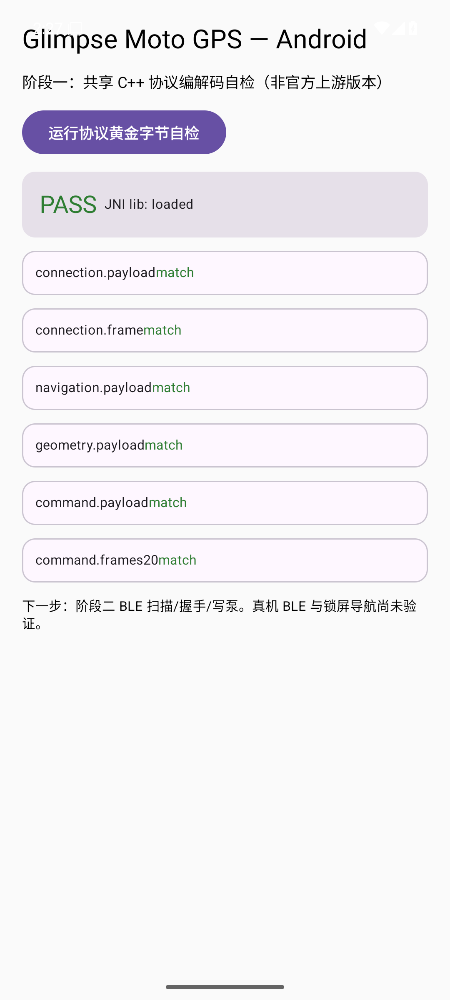

# Glimpse Moto GPS — Android（社区移植）

> 社区开发的 Android 配套 App，**非上游官方版本**。上游项目：
> https://github.com/mx3353672833-debug/moto-gps-waveshare
> 上游原创代码采用 [PolyForm Noncommercial 1.0.0](../../LICENSE.md)；本目录遵循同一许可证，
> 保留 [NOTICE](../../NOTICE) 与 [第三方说明](../../THIRD_PARTY_NOTICES.md)。
> 欢迎参与 Glimpse 共创：Issues / Pull Request 均可，实际贡献者会保留署名。

目标硬件：Waveshare ESP32-S3-Touch-AMOLED-1.75C（现有微雪固件，无需重刷、不改圆屏协议）。

## 架构

- **UI**：Kotlin + Jetpack Compose（Material 3），Activity 只负责挂载 Compose。
- **C++ 复用**：NDK + CMake + JNI 直接编译上游 `shared/ble_protocol`（帧/CRC/分片）与
  `shared/coordinates`（WGS84→GCJ-02），**不重写**这些逻辑；金标字节自检走同一份 C++。
- **分层**：UI → 导航会话 → 定位 / 网关 HTTP / BLE 传输 / 地图存储，逐层解耦。
- iOS 的 SwiftUI/CoreBluetooth/CoreLocation/ObjC++ 代码未复用；JNI 是新写的安卓适配层。

## 工具链（本机实际验证）

| 组件 | 版本 |
| --- | --- |
| JDK | Temurin 21.0.12.1+1 |
| Gradle | 9.5.0（wrapper 已提交） |
| AGP | 8.7.3 |
| Kotlin | 2.0.21 |
| compileSdk / targetSdk | 36 / 36 |
| minSdk | 26 |
| Build-Tools | 36.0.0 |
| NDK | 27.2.12479018 |
| CMake | 3.22.1 |
| ABI | arm64-v8a、x86_64 |

## 构建与测试

```powershell
# 仓库根目录，先拉子模块
git submodule update --init --recursive

cd platforms/android
# local.properties 只放本机 SDK 路径，已 gitignore
.\gradlew.bat assembleDebug          # app/build/outputs/apk/debug/app-debug.apk
.\gradlew.bat testDebugUnitTest      # JVM 单元测试
.\gradlew.bat connectedDebugAndroidTest   # 需已连接设备/模拟器：JNI 金标端到端
```

本机实测结果（2026-10-18）：

| 检查 | 结果 |
| --- | --- |
| `assembleDebug` | BUILD SUCCESSFUL |
| `assembleDebugAndroidTest` | BUILD SUCCESSFUL |
| `testDebugUnitTest` | **39 个测试通过**（协议常量、golden 结构、CRC、握手、队列、退避、网关 JSON、瓦片算法） |
| `connectedDebugAndroidTest`（Mi 10 真机） | **8/8 通过**：golden 字节、NavCore 桥、实时网关选路、实时瓦片下载、GCJ 反解、BLE 场景发送 |
| 模拟器安装 + App 内自检 | PASS，6/6 向量 match（`docs/android-phase1-selfcheck.png`） |
| **真机**：Xiaomi 14（23127PN0CC，Android 16） | 安装成功；扫描到 `MOTO GPS` 圆屏（RSSI -65 dBm，MAC 已省略） |
| 真机 BLE 握手 | **通过**：MTU 185 → frameSize 182，能力 `0xff`，三步握手完成 |
| 真机心跳 | **通过**：每秒收到设备 Heartbeat（type=2，11 字节），手机心跳持续发送 |
| 真机断开/重连 | **通过**：主动断开 → 空闲；重新选择设备 → 再次握手成功 |



## 接口依据（来自源码，不来自截图）

- Service `7e57a000-b50c-4b6a-9c57-40a54e8e1000`；手机写 `…a001`，订阅通知 `…a002`；
  CCCD `00002902-0000-1000-8000-00805f9b34fb`。
- 帧：magic `0xB7`、version 1、10 字节头 + payload + CRC-16/CCITT-FALSE（低字节先发）。
- 握手：Phone Starting → Device Ready → Phone Ready → Device Ready（session_id 必须一致）。
- 心跳 1000 ms，payload 为 `session_id + 会话内已用毫秒`（**不是**系统 uptime）。
- 网关：`GET /healthz`、`GET /v1/places`、`POST /v1/routes`、`POST /v1/route-options`、
  `GET /v1/map/cities`、`GET /v1/map/tiles/15/{x}/{y}`；请求 WGS84，路线/瓦片几何 GCJ-02。
- 文档与实现差异：ESP32 心跳失活阈值实为 `clamp(interval×3, 1500, 15000) ms`；
  `max_frame_size` 实际 clamp 到 [13, 512]；TrafficDeviation 段在 C++ 内部为 u32、线上为 u24。

## 开发进度

### 阶段一（工程、JNI、协议自检）— 已完成

| 项目 | 状态 |
| --- | --- |
| Gradle/Compose/NDK/CMake 工程，wrapper 提交 | 已实现 |
| JNI：crc16、fragmentMessage、decodeFrame、goldenVectors、wgs84ToGcj02 | 已实现并自动测试通过 |
| 上游 golden 字节端到端一致性 | 模拟器通过 |
| 协议常量与 fixture 结构 JVM 测试 | 通过 |
| CI：新增 android job（构建 + 单元测试 + 产物上传） | 已添加，待首次远端运行 |
| 真机 BLE 连接圆屏 | **通过**（Xiaomi 14，2026-10-18） |

### 阶段二（BLE 连接与握手）— 已完成基础链路

| 项目 | 状态 |
| --- | --- |
| 按服务 UUID 扫描、显式选择设备 | 已实现，真机通过 |
| GATT 连接、MTU 协商（不假设 512） | 已实现，真机 MTU=185 → 帧 182 |
| 订阅 TX Notify、三步握手、能力交集 | 已实现，真机通过 |
| 心跳（会话内计时）、设备存活超时 | 已实现，真机通过 |
| 断开清队列、退避重连（1/2/4/8/15/30 s） | 已实现；重连握手真机通过 |
| JNI：ConnectionStatus/Heartbeat/Ack 编解码、C++ 重组器句柄 | 已实现 |
| 128 帧队列、整消息原子入队、溢出清队 | 已实现并单测通过 |
| 15 ms 写泵节流 | 已实现（策略单测通过，真机未测满负载） |
| 配对/加密失败恢复 | **未验证**（当前设备 Just Works 直接成功） |
| 应用层 ACK 重试（750 ms ×2） | 尚未实现，仅对设备命令回 ACK |
| LVGL 显示数据（导航/几何/地图） | 尚未发送 |

### 阶段三（真实导航）— 真机全链路已通过

| 项目 | 状态 |
| --- | --- |
| 网关 `/healthz` `/v1/places` `/v1/routes`（404/405 回退 route-options） | 已实现；Mi 10 真机实时选路 **通过** |
| WGS84 请求 / GCJ-02 几何边界，request_id 回显校验 | 已实现并单测通过 |
| 定位：平台 LocationManager，GPS + 网络双源，拒绝陈旧/低精度 | 已实现；室内网络定位可用 |
| NavApp JNI：begin/fix/tick/accept/reject/snapshot | 已实现；Mi 10 仪器测试 **通过** |
| NavigationSnapshot 5 Hz、RouteGeometry 分块（带 ACK） | 真机 **通过**，几何 ACK=Ok |
| 圆屏实际渲染导航画面 | **真机通过**：圆屏由 READY 进入导航（2026-10-18 23:24） |
| 前台服务（location + connectedDevice）与结束通知 | 已实现；**熄屏 90 s 实测**：进程存活、FGS 常驻、5 Hz 快照持续写入 |
| 偏航重算、路况刷新 | 已实现（路况复用 /v1/routes 并回灌 NavCore），**未实车验证** |
| 设备手势切页（滑动/选页） | 已实现；真机通过（page 0/1/2 切换） |
| 音乐遥控（MediaState + 播放/上一首/下一首） | 已实现（系统媒体会话 + 通知使用权，无无障碍）；**待播放器实测** |

### 阶段四（离线地图）— 已实现并测试

| 项目 | 状态 |
| --- | --- |
| z15 WGS84 Web Mercator 分块（与 iOS 同一算法与测试向量） | 已实现；JVM 7 个测试通过 |
| GCJ-02→WGS84 反解（32 轮二分，调用 C++ 正变换） | 已实现；模拟器仪器测试与 iOS 向量一致 |
| 城市/区县搜索、范围下载、暂停/续传、删除、512 MiB 预算 | 已实现；真实瓦片下载 + 清单 + 删除模拟器 **通过** |
| 离线包只含背景道路与建筑、保留来源署名 | 已实现 |
| 向圆屏发送 MapScene | 尚未实现 |

### 调试入口（仅 debug 构建）

```text
adb shell am start -n dev.glimpse.motogps/.MainActivity \
  --es motoMac <圆屏 MAC> --es motoSearch 西湖
```

会直连圆屏、搜索目的地并在有定位后自动开始导航，便于无触屏验收；release 构建中该入口无效。

### 后续阶段

- 阶段五：偏航/路况、MapScene 投递、锁屏实测记录。
- 阶段六：预发布 APK、签名、SHA-256、GitHub Release。

## 网关地址（与 iOS 同步）

内置默认地址定义在 `GatewayConfig.DEFAULT_BASE_URL`，必须与
`platforms/ios/project.yml` 的 `MOTOGPSGatewayBaseURL` 保持一致：

```text
https://moto.menghuan.life/
```

- 只允许 `https`，或回环地址 `127.0.0.1` / `localhost` 上的 `http`（与 iOS 校验一致）。
- 末端路径自动补一个 `/`，调用 `v1/routes` 等接口时不会出现双斜杠。
- 高德 Web 服务 Key 只在网关后端，不进 APK。

## 权限说明

阶段一仅使用 `INTERNET`（后续阶段按需启用，已在 Manifest 声明但未在阶段一请求）：

- `BLUETOOTH_SCAN`（neverForLocation）/ `BLUETOOTH_CONNECT`：BLE 连接圆屏。
- `ACCESS_FINE_LOCATION` / `ACCESS_COARSE_LOCATION`：导航定位，与扫描权限分离。
- `FOREGROUND_SERVICE` + `LOCATION` / `CONNECTED_DEVICE`、`POST_NOTIFICATIONS`：阶段四。

## 当前限制

- BLE、锁屏导航、真实定位均未在真机验证；模拟器只证明编解码与 JNI 生命周期。
- `MOTO_BACKUP_DIR` 之类设备备份与本 App 无关；本 App 不上传轨迹或凭证。
- debug APK 为测试包，未签名发布。
